# Unified Service Scheduler — Detailed System Design

| | |
|---|---|
| **Scenario** | Keyloop Technical Assessment — Scenario A: The Unified Service Scheduler |
| **Status** | Approved |
| **Date** | 2026-10-28 |
| **Implemented layer** | Backend (REST API + PostgreSQL + Redis). Everything else is design-only. |
| **Overview** | [`01-high-level-design.md`](01-high-level-design.md) — decisions and flows on a few pages; this document is the full reference |
| **Companion** | [`docs/ai-collaboration/decision-log.md`](../ai-collaboration/decision-log.md) — every decision below, with the debate that produced it |

---

## 1. Intent

Car dealership workshops still book service work by phone and paper diaries. Two audiences
need one system:

- **B2C customers** book predefined service packages (e.g. Oil Change 45 min, Brake
  Inspection 75 min) for their vehicle at a chosen dealership and time — 24/7, in about two
  minutes, like Keyloop Service Booking or Xtime.
- **B2B workshop dispatchers** run the day on a live Gantt timeline of service bays and
  technicians: check vehicles in, move jobs by drag-and-drop, react to overruns.

The backend must allocate **one service bay and one qualified technician for the entire
service duration**, persist a confirmed `Appointment`, and **never double-book** a bay or a
technician — under concurrent traffic from many app instances, across a global footprint.

## 2. Goals, non-goals, anti-goals

**Goals**
1. Fulfil the three core requirements: resource-constrained booking; real-time availability
   check of bay **and** qualified technician for the full duration; persistent appointment
   record linking customer, vehicle, technician and bay.
2. Zero double-booking guaranteed by the database, not by application code or locks.
3. Read-heavy scaling (CQRS split, Redis, read replicas) sized for a Keyloop-scale estate.
4. Complete, production-shaped design for the parts not coded: UI, auth, multi-region,
   event streaming, autoscaling.
5. Runs end-to-end locally with one `docker compose up`, with logs searchable in OpenSearch.

**Non-goals (design-only or out of scope)**
- Frontend code (wireframes only, §15).
- Identity provider, login and JWT validation (gateway concern, §11).
- Message broker deployment, consumers (Email, Reporting) (§10).
- Multi-region deployment (§12) and Kubernetes manifests (§13).
- Pricing/upsell, courtesy-car/shuttle capacity, service-advisor capacity, technician
  clocking, parts — named in the domain (§6.6) so the design leaves room for them.

**Anti-goals (failure even if it "works")**
- Any path where two active appointments overlap on one bay or one technician.
- Correctness that depends on Redis, a distributed lock, or clock agreement between servers.
- A customer seeing or changing another customer's data by guessing an ID (IDOR).
- A design so elaborate the core booking path can't be tested end-to-end locally.

## 3. Assumptions

The challenge says to make reasonable assumptions and document them. These are ours:

| # | Assumption |
|---|---|
| A1 | Durations are arbitrary minutes (no fixed slot grid). The UI offers 15-minute start steps; the API accepts any minute. |
| A2 | A booking may contain several service types; they run back-to-back as **one** job in **one** bay with **one** technician who holds **all** required skills. Duration = sum. |
| A3 | The customer does not choose the technician or bay; the system allocates. Dispatchers may override. |
| A4 | Customers are authenticated (no guest bookings). Identity arrives as gateway-injected headers. |
| A5 | Airline-style **slot hold**: the chosen bay + technician are held in Redis for 10 minutes while the customer confirms (§8.6). Max one active hold per customer per dealership. The database remains the final authority. |
| A6 | Technicians work the dealership's opening hours unless blocked (leave, training). Bays are available during opening hours unless blocked (maintenance). Shift rosters are design-only. |
| A7 | Each dealership has a configurable **bay turnaround buffer** (default 0 min) added after a job on the bay only. |
| A8 | Every dealership, its customers and dispatchers belong to exactly one **region**; each region is a fully independent stack with its own database cluster. Requests are routed by the `region` claim in the JWT. Cross-region use (e.g. a customer booking abroad) is out of scope for this version (§12.4). |
| A9 | Booking rules differ per actor (§6.4): customers book `now + 2h` … 60 days ahead and may change/cancel until 24h before start; dispatchers can book walk-ins from `now − 15 min`, let jobs run past closing, and change any non-terminal job. |
| A11 | Walk-in / phone customers may have no login account. `customer.id` is an internal UUID; `idp_subject` links a login account when one exists (linking on later sign-up via verified email is design-only). |
| A10 | Reference data (dealerships, opening hours, bays, technicians, skills, service types) lives in the scheduler's own database and is **loaded by Flyway seed migrations**. How it is maintained in production (an admin/helper API, or a sync from the DMS) is **deferred** — no separate dealer service is designed. The scheduler is the system of record for appointments and reservations. |

## 4. Capacity estimate

Keyloop reports ~20,000 dealer sites in 100+ countries; one dealer group (Wilsons) reports
~500 online bookings/month. Our estimate:

| Metric | Derivation | Value |
|---|---|---|
| Bookings/day | 20k sites × ~1,000 bookings/month ÷ 30 | ~670k/day (~8/s average) |
| Peak writes | ×10 business-hour concentration × ~5 writes per booking lifecycle | ~400 writes/s |
| Availability reads | look-to-book ≈ 20:1, ×10 peak | ~1,500 reads/s |
| Dispatcher board reads | ~60k dispatchers refreshing every 30 s | ~2,000 reads/s |
| **Design target (×2–3 headroom)** | | **~10,000 reads/s, ~1,000 writes/s global** |

**Consequences**
- Writes are cheap. Contention only ever happens *inside one dealership* (a handful of
  requests per second at most), so a database exclusion constraint is ample; no
  sharded locking service is needed.
- Reads dominate ⇒ separate read path, cache, replicas (§9).
- Split over ~3 regions ⇒ ~3.3k reads/s and ~330 writes/s per region: one PostgreSQL
  primary + 2–3 replicas + a small Redis cluster per region.

## 5. Architecture

### 5.1 Global view

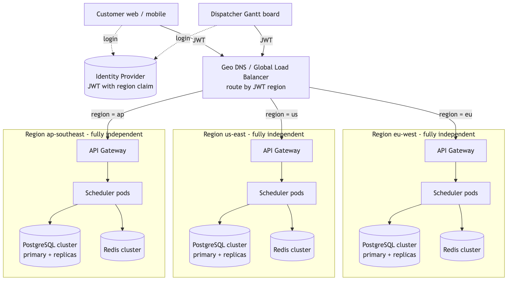

<sub>Source: [`docs/diagrams/01-global.mmd`](../diagrams/01-global.mmd)</sub>

Each region is a **fully independent stack** — its own gateway, scheduler pods, PostgreSQL
cluster (primary + replicas) and Redis. Regions share no data and never talk to each other
at request time. The identity provider puts a `region` claim in the JWT (the user's
region: sign-up region for customers, their dealerships' region for dispatchers), and the
global load balancer routes each request to that region.

### 5.2 Regional view (the part we implement is the Scheduler Service)

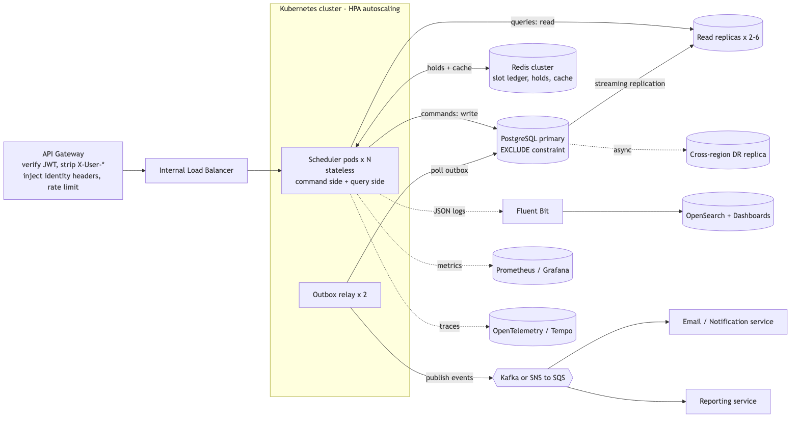

<sub>Source: [`docs/diagrams/02-regional.mmd`](../diagrams/02-regional.mmd)</sub>

### 5.3 Components

| Component | Role | Built? |
|---|---|---|
| Geo DNS / Global LB | Latency-based routing to nearest region; health-checked failover | Design |
| Identity Provider | OIDC login, issues short-lived JWT (15 min) + refresh token | Design |
| API Gateway | Verifies JWT signature/expiry/audience and that its `region` claim matches this region (else `421 Misdirected Request`); **removes** any client-sent `X-User-*` headers; injects identity headers (§11); rate limits; adds `X-Request-Id`/`traceparent` | Design |
| Internal ALB | Spreads traffic across stateless scheduler pods | Design (local: none, single app) |
| **Scheduler Service** | Spring Boot app: command side (booking, reschedule, transitions), query side (availability, Gantt, my appointments), outbox writer | **Built** |
| **PostgreSQL primary** | System of record; `EXCLUDE` constraints enforce zero double-booking | **Built** |
| **Read replica(s)** | Serve query-side reads | **Built** (one replica in Docker) |
| **Redis** | Cache-aside for catalog and per-dealership-day occupancy; never source of truth | **Built** |
| **Outbox + relay** | Same-transaction event capture; relay publishes to broker | Outbox table + relay with logging publisher **built**; Kafka/SNS adapters design |
| Broker, Email, Reporting | Downstream consumers | Design |
| Fluent Bit → OpenSearch | Centralised structured logs | **Built** (Docker) |
| Prometheus, OTel | Metrics and tracing | App exposes `/actuator/prometheus` + OTel instrumentation; backends design |

### 5.4 Inside the Scheduler Service (block diagram)

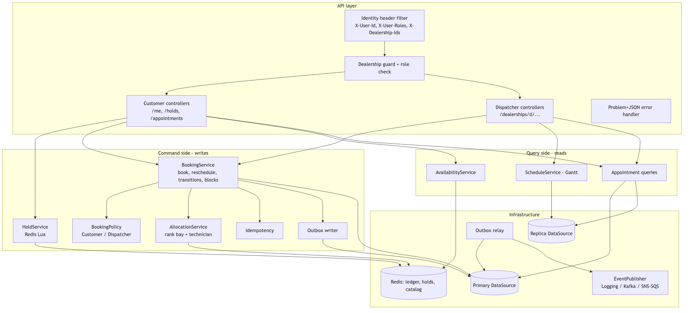

<sub>Source: [`docs/diagrams/06-service-blocks.mmd`](../diagrams/06-service-blocks.mmd)</sub>

## 6. Domain model and business rules

### 6.1 Entities

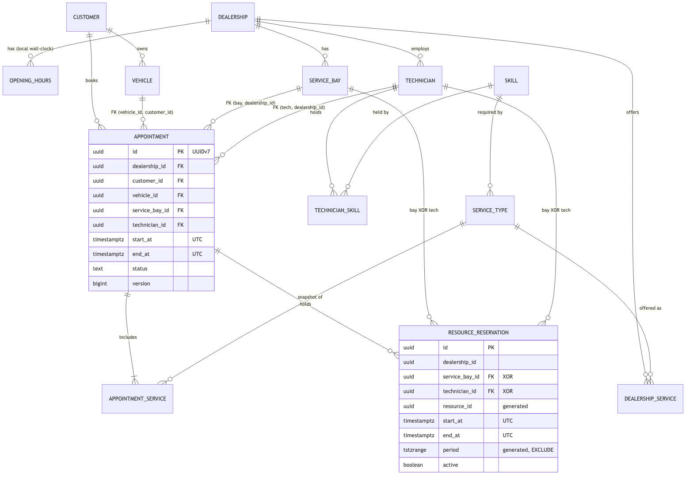

<sub>Source: [`docs/diagrams/03-erd.mmd`](../diagrams/03-erd.mmd)</sub>

- **Dealership** — `zoneId` (IANA, e.g. `Europe/London`), `homeRegion`, `bayBufferMinutes`.
- **ServiceType** — global catalog: `code`, `name`, `durationMinutes`, `requiredSkill`.
  `DealershipService` says which dealerships offer it (optional per-dealership duration override).
- **Technician** — belongs to one dealership; holds skills.
- **ServiceBay** — belongs to one dealership.
- **Customer** — internal UUID. `idp_subject` (nullable, unique) = `X-User-Id` for customers
  with a login; a self-service customer's profile is created on first use. Dispatchers can
  create customers without a login (walk-in / phone) — A11.
- **Vehicle** — owned by a customer: VIN (unique per owner), registration, make, model, year, mileage.
- **Appointment** — the confirmed record (requirement 3): customer, vehicle, dealership,
  bay, technician, services, period, status, version.
- **ResourceReservation** — one row per resource an appointment (or a block) occupies.
  This is where double-booking is made impossible (§8).

### 6.2 Appointment lifecycle

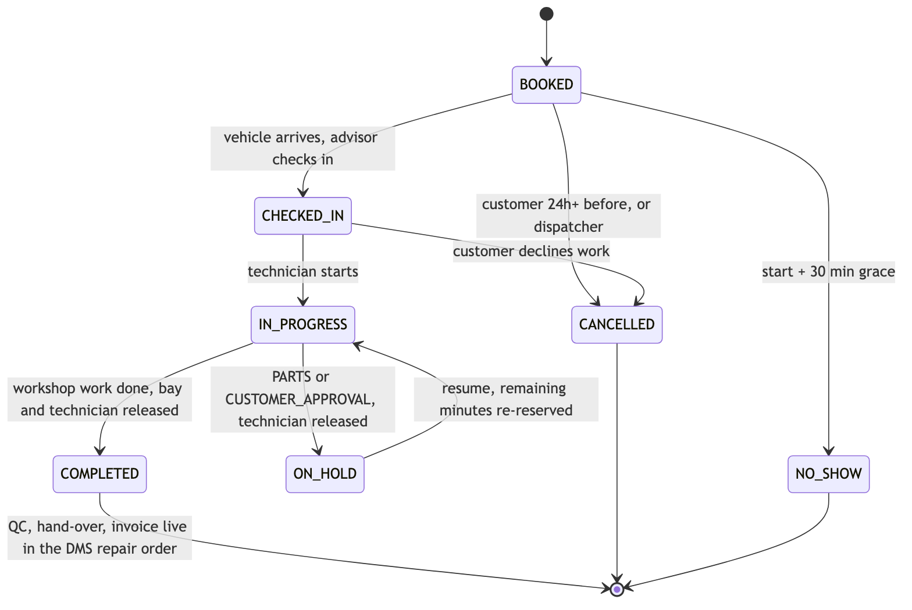

<sub>Source: [`docs/diagrams/04-lifecycle.mmd`](../diagrams/04-lifecycle.mmd)</sub>

| Transition | Effect on reservations |
|---|---|
| → `CANCELLED`, → `NO_SHOW` | Reservations set `active = false` ⇒ time is released immediately. Row kept for audit/reporting. |
| → `COMPLETED` | Means **workshop work is done**: both reservations end at completion time ⇒ remaining planned time released (bay keeps its buffer). Quality check, hand-over to the customer and invoicing belong to the DMS **repair order**, not to this scheduler; the DMS listens to `AppointmentStatusChanged`. |
| → `ON_HOLD` | Requires `holdReason`: `PARTS` (waiting for parts) or `CUSTOMER_APPROVAL` (extra work found, waiting for the customer's go-ahead). Minutes worked so far are added to `worked_minutes`. **Technician reservation ends at `now()`** — the technician moves on to other jobs. **Bay is kept** by default (car stays on the lift); with `releaseBay: true` the bay reservation also ends at `now()` (car moved to the yard). |
| `ON_HOLD` → `IN_PROGRESS` (`RESUME`) | Dispatcher gives `resumeAt` (default now) and optionally another technician/bay. Remaining minutes = planned duration − `worked_minutes`. Both reservations are set to `[resumeAt, resumeAt + remaining)` (bay + buffer) and `appointment.period` end moves accordingly, in one transaction ⇒ `409 SLOT_UNAVAILABLE` if that conflicts, and the dispatcher picks another time or person. |
| Overrun (`IN_PROGRESS` past planned end) | Not auto-extended. Gantt shows overrun; dispatcher extends via resize, which can conflict ⇒ dispatcher resolves by moving later jobs. |

Past segments (time already worked before a hold) are not kept in `resource_reservation`:
nobody can book the past, so only current and future occupancy matters for conflicts. The
work history lives in the appointment row (`worked_minutes`) and in the events.

Any transition not in the diagram ⇒ `409 INVALID_TRANSITION`.

**Out of scope (documented, not built):** multi-day jobs, a `CONFIRMED` state from reminder
replies, technician clock-on/off, and the post-workshop chain (QC → ready for collection →
collected → invoiced), which is the DMS repair order's job.

### 6.3 Booking rules (validation order)

Customer booking, in order. Dispatcher differences are in §6.4.

1. Caller is a `CUSTOMER` and owns `vehicleId` (else `404`, see §11.3).
2. Dealership exists and offers every requested service; 1–5 services, no duplicates.
3. `start` is within the booking window (A9); compared using **database time** (§12.3).
4. Duration = Σ service durations. Period `[start, start + duration)` lies inside one day's
   opening hours in the dealership's zone (no overnight jobs) ⇒ else `422 OUTSIDE_OPENING_HOURS`.
5. Allocate a bay + technician (§8.3) ⇒ else `409 SLOT_UNAVAILABLE` with up to 5 alternatives.

### 6.4 Rules per actor (booking, reschedule, cancel)

Implemented as one `BookingPolicy` interface with `CustomerBookingPolicy` and
`DispatcherBookingPolicy`; the allocation and persistence code is shared.

| Rule | Customer | Dispatcher |
|---|---|---|
| Earliest start | DB `now() + 2h` | DB `now() − 15 min` (walk-in) |
| Latest start | 60 days ahead | 60 days ahead |
| Opening hours | Whole job inside one day's opening hours | **Start** inside opening hours; **end may pass closing** (overtime / overrun) |
| Start granularity | Any minute (UI offers 15-min steps) | Any minute |
| Change / cancel window | Own `BOOKED` jobs, until 24h before start; reschedule re-allocates resources via a new hold | Any non-terminal job, no time cutoff |
| `CHECKED_IN` | — | Move time, change bay/technician, resize |
| `IN_PROGRESS` | — | Start is fixed; may change bay/technician or extend/shrink the end |
| `ON_HOLD` | — | Only `RESUME` (with a new start) or release the bay; no drag-and-drop until resumed |
| Choose resources | No (system allocates) | Optional: pin bay and/or technician (technician must hold all required skills ⇒ else `422 TECHNICIAN_NOT_QUALIFIED`) |
| Other | — | Status transitions; book for a customer (phone/walk-in), create customer + vehicle inline; create/remove resource blocks |

### 6.5 Resource blocks

Dispatchers block a bay (maintenance) or technician (leave, training) for a period. Blocks
are `ResourceReservation` rows with `kind = BLOCK`, so the same constraint stops a block
overlapping an appointment and vice versa. Creating a block over existing appointments fails
with `409` listing the conflicts — the dispatcher moves those first.

### 6.6 Design-only domain extensions

Shaped so they slot in later without reworking the core:

- **Transport options** (wait, drop-off, courtesy car, shuttle): courtesy cars become another
  reservable resource type ⇒ one more reservation row per booking, same constraint.
- **Service-advisor capacity**: a per-dealership "check-ins per 15 min" counter resource.
- **Pricing & upsell**: price on `DealershipService`; appointment stores a price snapshot.
- **Technician clocking & shift rosters**: rosters become `AVAILABLE` windows; clocking feeds
  actual vs. estimated time to Reporting.

## 7. Data model (PostgreSQL 16)

Schema sketch — the builder owns final DDL and Flyway migrations. Every design choice
that is not obvious carries its reason, either as a comment or in §7.1–7.4 below.

**Time rule: everything is UTC.** All instants are `timestamptz`; the database runs with
`timezone = 'UTC'`, the JVM with `-Duser.timezone=UTC`, JDBC sessions in UTC. The **only**
local-time data is a dealership's opening hours (see §7.3 for why).

```sql
CREATE EXTENSION IF NOT EXISTS btree_gist;   -- lets GiST indexes mix "=" on uuid with "&&" on ranges

CREATE TABLE dealership (
  id                 uuid PRIMARY KEY,
  name               text NOT NULL,
  zone_id            text NOT NULL,            -- IANA zone; used only to interpret opening hours and for display
  bay_buffer_minutes int  NOT NULL DEFAULT 0 CHECK (bay_buffer_minutes BETWEEN 0 AND 60)
);

-- Local wall-clock hours on purpose (§7.3)
CREATE TABLE opening_hours (
  dealership_id uuid NOT NULL REFERENCES dealership(id),
  day_of_week   smallint NOT NULL CHECK (day_of_week BETWEEN 1 AND 7),  -- ISO, Monday = 1
  opens_at      time NOT NULL,
  closes_at     time NOT NULL CHECK (closes_at > opens_at),
  PRIMARY KEY (dealership_id, day_of_week)
);

CREATE TABLE skill        (code text PRIMARY KEY, name text NOT NULL);
CREATE TABLE service_type (id uuid PRIMARY KEY, code text UNIQUE NOT NULL, name text NOT NULL,
                           duration_minutes int NOT NULL CHECK (duration_minutes BETWEEN 5 AND 600),
                           required_skill text NOT NULL REFERENCES skill(code));
CREATE TABLE dealership_service (dealership_id uuid REFERENCES dealership(id),
                                 service_type_id uuid REFERENCES service_type(id),
                                 duration_override_minutes int CHECK (duration_override_minutes BETWEEN 5 AND 600),
                                 PRIMARY KEY (dealership_id, service_type_id));

-- UNIQUE (id, dealership_id) exists only so other tables can reference "this bay AND this dealership" (§7.1, fix 2)
CREATE TABLE service_bay (id uuid PRIMARY KEY, dealership_id uuid NOT NULL REFERENCES dealership(id),
                          name text NOT NULL, active boolean NOT NULL DEFAULT true,
                          UNIQUE (id, dealership_id));
CREATE TABLE technician  (id uuid PRIMARY KEY, dealership_id uuid NOT NULL REFERENCES dealership(id),
                          display_name text NOT NULL, active boolean NOT NULL DEFAULT true,
                          UNIQUE (id, dealership_id));
CREATE TABLE technician_skill (technician_id uuid REFERENCES technician(id),
                               skill_code text REFERENCES skill(code),
                               PRIMARY KEY (technician_id, skill_code));

CREATE TABLE customer (id uuid PRIMARY KEY,                 -- internal id (walk-ins have no login)
                       idp_subject uuid UNIQUE,              -- = X-User-Id when the customer has a login; NULL for walk-ins
                       display_name text NOT NULL, email text, phone text,
                       created_by uuid NOT NULL,             -- self or dispatcher
                       created_at timestamptz NOT NULL DEFAULT now());
-- Prefix search "abc%" needs text_pattern_ops; a plain btree can't serve LIKE under a non-C collation (§7.2, fix 6)
CREATE INDEX customer_email_prefix ON customer (lower(email) text_pattern_ops);
CREATE INDEX customer_phone_prefix ON customer (phone text_pattern_ops);

CREATE TABLE vehicle  (id uuid PRIMARY KEY, customer_id uuid NOT NULL REFERENCES customer(id),
                       vin char(17) NOT NULL, registration text, make text, model text,
                       model_year smallint, mileage int CHECK (mileage >= 0),
                       UNIQUE (customer_id, vin),            -- also serves "vehicles of customer X"
                       UNIQUE (id, customer_id));            -- target of the composite FK below (§7.1, fix 3)
CREATE INDEX vehicle_registration_prefix ON vehicle (upper(registration) text_pattern_ops);

CREATE TABLE appointment (
  id             uuid PRIMARY KEY,                 -- UUIDv7: time-ordered ⇒ inserts append to the btree's right edge
  dealership_id  uuid NOT NULL REFERENCES dealership(id),
  customer_id    uuid NOT NULL REFERENCES customer(id),
  vehicle_id     uuid NOT NULL,
  service_bay_id uuid NOT NULL,
  technician_id  uuid NOT NULL,
  start_at       timestamptz NOT NULL,             -- UTC; plain columns are easy to index, sort and partition (§7.4)
  end_at         timestamptz NOT NULL CHECK (end_at > start_at),
  period         tstzrange GENERATED ALWAYS AS (tstzrange(start_at, end_at, '[)')) STORED,
  status         text NOT NULL CHECK (status IN ('BOOKED','CHECKED_IN','IN_PROGRESS','ON_HOLD','COMPLETED','CANCELLED','NO_SHOW')),
  hold_reason    text CHECK (hold_reason IN ('PARTS','CUSTOMER_APPROVAL')),  -- set while ON_HOLD
  worked_minutes int NOT NULL DEFAULT 0,           -- accumulated on HOLD / COMPLETE
  started_at     timestamptz,                      -- start of the current IN_PROGRESS stint
  version        bigint NOT NULL DEFAULT 0,        -- optimistic locking
  customer_notes text,
  created_by     uuid NOT NULL,
  created_at     timestamptz NOT NULL DEFAULT now(),
  updated_at     timestamptz NOT NULL DEFAULT now(),
  -- Composite FKs: the database itself refuses a bay/technician from another dealership
  -- and a vehicle owned by another customer (§7.1, fixes 2 and 3)
  FOREIGN KEY (service_bay_id, dealership_id) REFERENCES service_bay (id, dealership_id),
  FOREIGN KEY (technician_id,  dealership_id) REFERENCES technician  (id, dealership_id),
  FOREIGN KEY (vehicle_id,     customer_id)   REFERENCES vehicle     (id, customer_id)
);
CREATE INDEX appointment_dealership_day ON appointment (dealership_id, start_at)
  INCLUDE (end_at, status, service_bay_id, technician_id);           -- Gantt + dispatcher lists, index-only friendly
CREATE INDEX appointment_customer_timeline ON appointment (customer_id, start_at DESC, id);  -- "my appointments" + cursor

CREATE TABLE appointment_service (appointment_id uuid REFERENCES appointment(id),
                                  service_type_id uuid REFERENCES service_type(id),
                                  position smallint NOT NULL,
                                  duration_minutes int NOT NULL,   -- snapshot: later catalog changes don't rewrite history
                                  PRIMARY KEY (appointment_id, service_type_id));

-- The zero-double-booking table
CREATE TABLE resource_reservation (
  id             uuid PRIMARY KEY,
  dealership_id  uuid NOT NULL,
  -- Exactly one of the two is set: real FKs instead of an unchecked polymorphic id (§7.1, fix 1)
  service_bay_id uuid,
  technician_id  uuid,
  resource_id    uuid GENERATED ALWAYS AS (coalesce(service_bay_id, technician_id)) STORED,
  appointment_id uuid REFERENCES appointment(id),  -- NULL for blocks
  kind           text NOT NULL CHECK (kind IN ('APPOINTMENT','BLOCK')),
  start_at       timestamptz NOT NULL,
  end_at         timestamptz NOT NULL CHECK (end_at > start_at),
  period         tstzrange GENERATED ALWAYS AS (tstzrange(start_at, end_at, '[)')) STORED,
  active         boolean NOT NULL DEFAULT true,
  reason         text,                             -- for blocks
  CHECK (num_nonnulls(service_bay_id, technician_id) = 1),
  CHECK ((kind = 'APPOINTMENT') = (appointment_id IS NOT NULL)),
  FOREIGN KEY (service_bay_id, dealership_id) REFERENCES service_bay (id, dealership_id),
  FOREIGN KEY (technician_id,  dealership_id) REFERENCES technician  (id, dealership_id),
  CONSTRAINT no_double_booking
    EXCLUDE USING gist (resource_id WITH =, period WITH &&) WHERE (active)
);
-- GiST, not btree: "period && :window" can only use a GiST index (§7.2, fix 4)
CREATE INDEX reservation_dealership_window ON resource_reservation
  USING gist (dealership_id, period) WHERE active;
-- Every reschedule / transition updates reservations BY appointment_id (§7.2, fix 5)
CREATE INDEX reservation_by_appointment ON resource_reservation (appointment_id) WHERE appointment_id IS NOT NULL;
CREATE INDEX reservation_archival ON resource_reservation (end_at);   -- nightly archival scan

CREATE TABLE outbox_event (
  id               uuid PRIMARY KEY,
  aggregate_type   text NOT NULL,
  aggregate_id     uuid NOT NULL,
  aggregate_version bigint NOT NULL,
  dealership_id    uuid NOT NULL,                  -- partition / ordering key for the broker
  event_type       text NOT NULL,
  payload          jsonb NOT NULL,
  occurred_at      timestamptz NOT NULL DEFAULT now(),
  published_at     timestamptz
);
CREATE INDEX outbox_unpublished ON outbox_event (occurred_at) WHERE published_at IS NULL;  -- relay poll stays tiny
CREATE INDEX outbox_published   ON outbox_event (published_at) WHERE published_at IS NOT NULL; -- cleanup job

CREATE TABLE idempotency_key (
  key           text NOT NULL,
  user_id       uuid NOT NULL,
  request_hash  text NOT NULL,
  response_code int,
  response_body jsonb,
  created_at    timestamptz NOT NULL DEFAULT now(),
  PRIMARY KEY (user_id, key)
);
CREATE INDEX idempotency_expiry ON idempotency_key (created_at);
```

Why one `resource_reservation` table rather than constraints on `appointment`: a single
constraint covers bays, technicians, blocks, the bay buffer and future resource types
(courtesy cars) uniformly. `tstzrange` is half-open `[)`, so back-to-back jobs
(09:00–09:45, 09:45–11:00) are legal.

### 7.1 Relationship integrity — what the database enforces, and why

| # | Rule | How | Why (what goes wrong without it) |
|---|---|---|---|
| 1 | A reservation points at a real bay **or** a real technician | Two nullable FK columns + `CHECK (num_nonnulls(...) = 1)`; `resource_id` is a generated column so `EXCLUDE` still works on one column | With a single polymorphic `resource_id` there can be no foreign key: a typo or a deleted technician leaves a reservation pointing at nothing, silently blocking or freeing time |
| 2 | Bay and technician belong to the appointment's dealership | Composite FK `(service_bay_id, dealership_id) → service_bay(id, dealership_id)` (same for technician, and on reservations) | An app bug could assign Dealer B's bay to Dealer A's job: Dealer B's board shows a phantom booking and Dealer A's job has no real bay. A tenant-isolation leak, not just bad data |
| 3 | The vehicle belongs to the appointment's customer | Composite FK `(vehicle_id, customer_id) → vehicle(id, customer_id)` | IDOR protection would live only in Java; any missed check (or a future endpoint) could attach someone else's car. Now the database is a second wall |
| — | Reservation kind matches its link | `CHECK ((kind = 'APPOINTMENT') = (appointment_id IS NOT NULL))` | Prevents orphan "appointment" reservations and blocks wrongly tied to a job |
| — | Appointment's bay/technician columns duplicate the active reservations | Deliberate denormalisation, kept consistent by a single repository method per command + an invariant integration test | Gantt and list queries read one table instead of joining reservations; the invariant test (§17) catches drift |
| — | No `ON DELETE CASCADE` anywhere | Default `RESTRICT`; bays/technicians are deactivated (`active = false`), never deleted | Deleting a technician must not silently erase appointment history or free booked time |

### 7.2 Indexes — each one exists for a named query

| Index | Serves | Why this shape |
|---|---|---|
| `no_double_booking` (GiST `resource_id =, period &&`, partial `active`) | The overlap check on every insert/update; also "is this resource free?" | Only GiST can test range overlap; partial so cancelled rows cost nothing |
| `reservation_dealership_window` (GiST `dealership_id, period`, partial `active`) | Loading a dealership-day for the Redis ledger and the direct booking path | **Fix 4**: the earlier btree on a range column could not be used by `&&` ⇒ full scans |
| `reservation_by_appointment` | Reschedule, transitions, cancel (`WHERE appointment_id = ?`) | **Fix 5**: was missing; every status change would have scanned the table |
| `reservation_archival (end_at)` | Nightly delete of rows ended > 30 days | Keeps the GiST indexes small forever |
| `appointment_dealership_day (dealership_id, start_at) INCLUDE (…)` | Gantt day view, dispatcher lists | Equality on dealership then range on time; `INCLUDE` lets the board be served mostly from the index |
| `appointment_customer_timeline (customer_id, start_at DESC, id)` | "My appointments" with cursor pagination | Matches the `ORDER BY start_at DESC, id` cursor exactly — no sort step |
| `customer_email_prefix`, `customer_phone_prefix`, `vehicle_registration_prefix` (`text_pattern_ops`) | Dispatcher customer search by prefix | **Fix 6**: `LIKE 'abc%'` can't use a default-collation btree |
| `outbox_unpublished` (partial) | Relay poll | Only unpublished rows are indexed ⇒ the poll stays O(backlog), not O(history) |
| `outbox_published`, `idempotency_expiry` | Cleanup jobs | Bounded deletes instead of full scans |

Foreign keys that are never joined from the child side (e.g. `appointment_service.service_type_id`)
deliberately get no extra index: rows are never deleted from the parent, so the index would
only slow writes.

### 7.3 UTC everywhere — and the one exception

| Data | Stored as | Why |
|---|---|---|
| Appointment / reservation / block times | `timestamptz` UTC (`start_at`, `end_at`) | One unambiguous instant; comparisons and overlap maths never depend on a zone; replicas, logs and events in all regions line up |
| API responses | UTC with `Z` (`2026-11-02T09:00:00Z`) + the dealership's `timeZone` | Client renders local time with the IANA zone; server never formats per-user times |
| API input | ISO-8601 with any offset (`…Z` or `…+07:00`) | Unambiguous; converted to UTC on arrival |
| Logs, events, metrics | UTC (`Z`) | Cross-region correlation without mental conversion |
| **Opening hours** | **Local wall-clock** `time` + dealership `zone_id` | A workshop opens at 08:00 *local* all year. Stored in UTC it would "move" to 07:00 or 09:00 at every daylight-saving switch. The server converts to UTC per date (`ZonedDateTime`) when it needs instants |

The earlier `local_start` column is **removed**: local time is always derivable from
`start_at` + `zone_id`. The design-only tzdata-change reconciliation (§12.2) compares
against opening hours instead.

### 7.4 Scaling the data

| Table | Growth (per region, from §4) | Plan |
|---|---|---|
| `resource_reservation` | Only active + last 30 days kept | Archival job ⇒ stays small; GiST insert cost stays flat |
| `appointment`, `appointment_service` | ~80M rows/year | Not partitioned in this version — with the two composite indexes above, single-dealership and single-customer queries touch a handful of index pages. **Evolution:** range-partition by month on `start_at` (that is why it is a plain column) and move partitions older than 24 months to the reporting warehouse |
| `outbox_event` | ~5 rows per booking | Cleanup job deletes rows published > 7 days ago |
| `idempotency_key` | 1 row per booking request | Deleted after 24h |
| Reference data (dealership, bays, technicians, services) | Tiny | Cached in Redis; read from replicas |

All primary keys are UUIDv7, so inserts land at the right edge of each btree (no random
page splits like UUIDv4) while IDs stay unguessable enough for public URLs (authorization
still comes from §11.3).

## 8. Concurrency control — zero double-booking

### 8.1 The guarantee

`no_double_booking` makes it **physically impossible** for two active reservations on the
same resource to overlap, regardless of how many app instances race. PostgreSQL checks the
GiST exclusion index at insert/update; a conflicting transaction fails with SQLSTATE
`23P01 exclusion_violation`. No Redis lock and no `SERIALIZABLE` needed; `READ COMMITTED` is
enough.

**Found by the concurrency tests — exclusion-wait deadlocks.** PostgreSQL's exclusion check
inserts the new index entry first and *then* waits on any in-progress conflicting entry. Two
transactions inserting overlapping ranges at the same instant therefore wait on each other —
a deadlock (`40P01`) that no insert ordering prevents. With 50 simultaneous requests for one
slot the first test run produced 209 deadlocks. **Fix:** before writing reservations, each
transaction takes `pg_advisory_xact_lock` on every resource it will touch, in one global
order (sorted, de-duplicated). Writers to the same bay/technician now queue instead of
deadlocking; the lock is transaction-scoped (released at commit/rollback, safe with PgBouncer
transaction pooling). The lock only serialises writers per resource — **the `EXCLUDE`
constraint remains the sole correctness guarantee**: the code still inserts and still handles
`23P01`. Result: 0 deadlocks, every race test green. Every writer of `resource_reservation`
(booking, confirm, reschedule, drag-and-drop, resume, blocks) uses the same lock helper.

### 8.2 Why not the alternatives

| Option | Verdict |
|---|---|
| Check-then-insert in app code | Race between check and insert ⇒ double-booking. Rejected. |
| Redis / Redlock distributed lock | No fencing token ⇒ a paused process can write after its lock expired. Not a guarantee. Rejected. |
| `SELECT … FOR UPDATE` on a per-dealership row | Correct, but serialises every booking in a dealership even when resources don't overlap; also needs care across 2 resources. Kept as a fallback idea only. |
| Fixed 15-min slot table with unique `(resource, slot)` | Correct, but forces a grid, multiplies rows (75 min = 5 rows × 2 resources), awkward for resize. Rejected given A1. |
| `SERIALIZABLE` isolation | Correct but higher abort rates and harder reasoning. Unneeded. |
| **`EXCLUDE` on `tstzrange`** | Correct, lock-free from the app's view, arbitrary durations, one constraint for all resource types. **Chosen.** |

### 8.3 Allocation and persistence (`POST /me/appointments`, `POST /dealerships/{d}/appointments`)

Normal customer path: the pair was already chosen and held in Redis (§8.6), so this runs
**once** with that pair. The candidate loop below is the **direct path**, used when no
hold is given (dispatcher bookings, API clients, Redis unavailable).

```
validate (§6.3 / §6.4 policy)
period    = [start, start + Σduration)
bayPeriod = [start, start + Σduration + bayBufferMinutes)

candidates = query on PRIMARY:
  technicians in dealership, active, holding ALL required skills,
      with no active reservation overlapping period
  bays in dealership, active,
      with no active reservation overlapping bayPeriod
rank technicians by booked minutes that day (least-loaded first), tie → random
rank bays by random  (spreads concurrent requests over different pairs ⇒ fewer collisions)

for attempt in 1..3 (pairs taken in rank order):
    BEGIN (READ COMMITTED)
      INSERT idempotency_key (IN_PROGRESS)       -- first: a concurrent duplicate blocks here (§8.5)
      INSERT appointment, appointment_service rows
      INSERT both reservations, ordered by resource_id   -- fixed lock order ⇒ no deadlocks (§8.7)
      INSERT outbox_event AppointmentBooked
      UPDATE idempotency_key SET response
    COMMIT
    on 23P01 → ROLLBACK, drop the conflicting resource from candidates,
               mark the Redis ledger for that dealership-day dirty (§8.6), next attempt
    on success → after-commit: write-through ledger (hold → confirmed); return 201

if no pair succeeded → 409 SLOT_UNAVAILABLE + alternatives (§9.3)
```

The bay and technician reservations are inserted **in one transaction**, so there is never a
state where the bay is taken but the technician is not.

### 8.4 Dispatcher moves (drag-and-drop) — optimistic locking

Before touching the database the target interval is checked against the Redis ledger
(§8.6): overlap with a customer's live hold ⇒ `409 SLOT_HELD`, unless the request says
`"overrideHold": true` (the hold is revoked; that customer's confirm will get `409`).

`PATCH` carries `If-Match: "<version>"`. In one transaction:

```
UPDATE appointment SET ..., version = version + 1
 WHERE id = :id AND dealership_id = :d AND version = :expected      -- 0 rows ⇒ 412 VERSION_CONFLICT
UPDATE resource_reservation SET service_bay_id | technician_id = ..., start_at = ..., end_at = ...
 WHERE appointment_id = :id AND active                               -- 23P01 ⇒ 409 SLOT_UNAVAILABLE
INSERT outbox_event AppointmentRescheduled
```

Two dispatchers dragging the same job: the second gets `412` and the UI snaps the card
back and refreshes. A dispatcher dragging onto a slot a customer just booked: `409`,
snap back, the response names the conflicting appointment.

**Status transitions** are a single conditional statement, so two concurrent actions
(e.g. check-in vs. cancel) cannot both succeed:

```
UPDATE appointment SET status = :to, version = version + 1
 WHERE id = :id AND dealership_id = :d AND status = ANY(:allowedFrom)   -- 0 rows ⇒ 409 INVALID_TRANSITION
```

Customer cancel uses the same statement with `allowedFrom = {BOOKED}` and the 24h check
against DB `now()` in the `WHERE` clause.

### 8.5 Idempotency

Appointment-creating `POST`s (customer and dispatcher) require an `Idempotency-Key` header. A
retry with the same key and same body returns the stored response; same key with a
different body ⇒ `422 IDEMPOTENCY_KEY_REUSED`. Keys expire after 24h (cleanup job). This
stops a flaky mobile connection from creating two bookings.

The key row is the **first** insert of the booking transaction. Two identical requests
arriving together: the second blocks on the primary-key index until the first commits,
gets `unique_violation`, rolls back and returns the first one's stored response (or `409
REQUEST_IN_PROGRESS` if the first rolled back mid-flight and the client should retry).

### 8.6 Slot holds in Redis (airline-style)

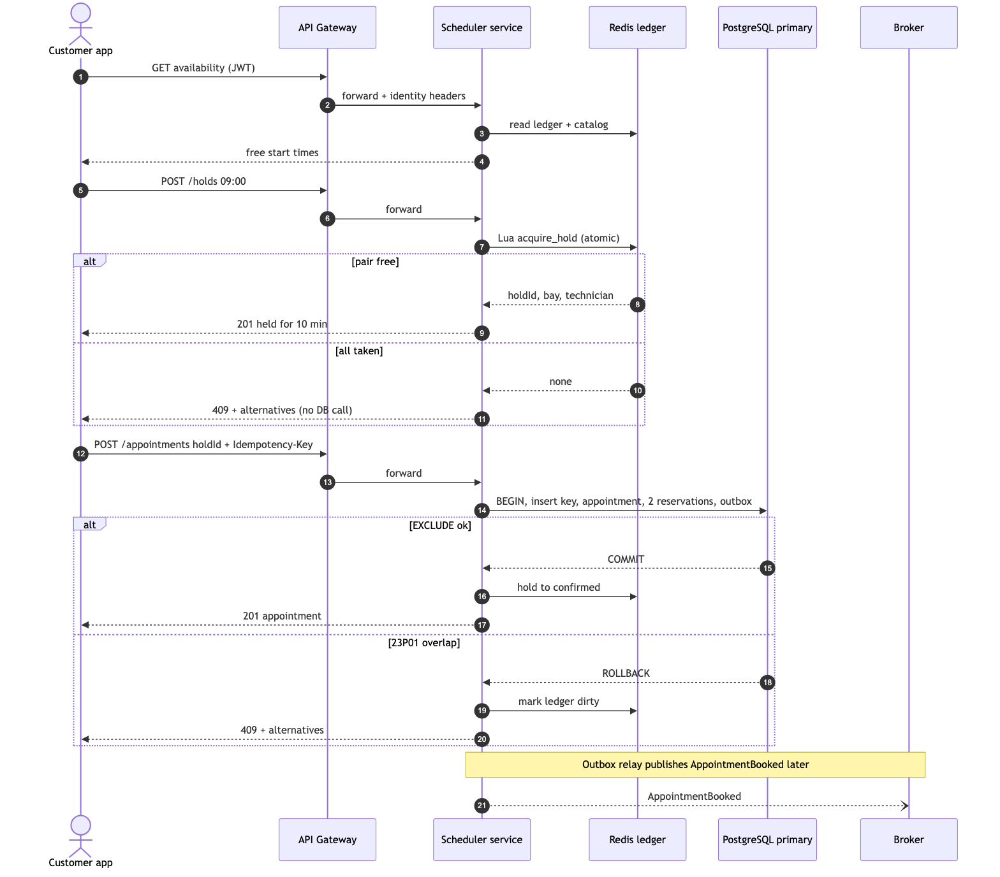

<sub>Source: [`docs/diagrams/07-booking-sequence.mmd`](../diagrams/07-booking-sequence.mmd)</sub>

Two jobs: **UX** — the slot the customer picked is theirs for 10 minutes while they review;
**contention shield** — competing requests for a hot slot are rejected in Redis in ~1 ms and
never reach PostgreSQL, so a promotion spike cannot exhaust database connections.

**Slot ledger.** All keys for one dealership-day share the hash tag
`{d:<dealershipId>:<localDate>}`, so they live in one Redis Cluster slot and one Lua script
can read and write them atomically:

| Key | Type | Content |
|---|---|---|
| `ledger:{…}:<resourceId>` | sorted set | intervals on that bay/technician; member `R:<reservationId>:<startMs>:<endMs>` (confirmed, mirrored from DB) or `H:<holdId>:<startMs>:<endMs>:<expiresMs>` (hold); score = start |
| `hold:{…}:<holdId>` | hash, TTL 10 min | `userId`, `technicianId`, `bayId`, period, service ids, `expiresAt` |
| `userhold:{…}:<userId>` | string, TTL 10 min | the user's current hold id (one hold per user per dealership-day) |
| `ledger-loaded:{…}` | string, TTL 10 min | marker; missing ⇒ ledger rebuilt from the **primary** (one indexed query) before use |
| `holdref:<holdId>` | string, TTL 10 min | `<dealershipId>:<localDate>` — lets `GET/DELETE /me/holds/{id}` find the hold without exposing Redis key structure in the API (no hash tag: read before the Lua call) |

**`POST /me/holds`**
1. Validate with the caller's policy (§6.3 rules 1–4). No DB write.
2. Ensure the ledger is loaded.
3. Lua `acquire_hold`: take time from Redis `TIME` (one clock); drop expired `H` members of
   the touched sets; release the caller's previous hold; walk the ranked technician × bay
   pairs (§8.3 ranking, catalog from cache) and take the first pair where neither sorted
   set overlaps the requested interval; add `H` members to both sets and create the hold.
4. Pair found ⇒ `201 { holdId, expiresAt, start, end }`. None ⇒ `409 SLOT_UNAVAILABLE` +
   alternatives computed from the ledger. **No database access in either case.**

**Confirm** — `POST /me/appointments` with `holdId`:
1. Hold must belong to the caller and match the request body (else `404` / `422`).
2. Database transaction (§8.3) with the held pair — `EXCLUDE` is the final check.
3. After commit, Lua turns the `H` members into `R` members and deletes the hold.
4. If the hold had expired: the insert is still attempted — free slot ⇒ `201`; taken ⇒ `409`.

**Write-through.** Every other committed change to reservations (dispatcher move, cancel,
block, early completion) updates the ledger after commit. Any `23P01` from the database
deletes `ledger-loaded:{…}`, so the next request rebuilds that dealership-day from the
primary — the ledger heals itself.

**Why Redis can never cause a double booking**

| Failure | Outcome |
|---|---|
| Redis failover loses recent holds / ledger entries | Next request may hold an already-taken pair ⇒ `EXCLUDE` rejects at confirm ⇒ `409`, ledger rebuilt. Never two bookings. |
| App crashes between DB commit and ledger update | Ledger misses one `R` entry ⇒ same as above until self-heal or the 10-min marker TTL. |
| Process pauses (GC) past hold TTL | Hold expires; the database still decides. |
| Redis completely down | `POST /me/holds` ⇒ `503`; client books via the direct path (§8.3); availability is computed from the database. Slower, still correct. |
| Hold hoarding (one user blocking many slots) | One hold per user per dealership-day; gateway rate limit on `/holds`. |

### 8.7 Consistency and race review

Every write path checked against: double booking, inconsistent data, read/write races,
performance.

| # | Risk | Mitigation |
|---|---|---|
| 1 | Two requests book overlapping time on one bay/technician | `EXCLUDE` on `resource_reservation` (§8.1); Redis hold filters most collisions earlier (§8.6) |
| 2 | Bay taken but technician not (partial booking) | Both reservations, appointment and outbox in **one** transaction |
| 3 | `appointment.period` disagrees with its reservations | Only changed together in one transaction by one repository method; integration test asserts the invariant after every command |
| 4 | Deadlock: concurrent writers on the same resource (exclusion-wait deadlock, or opposite update order) | Per-resource `pg_advisory_xact_lock` taken in one global (sorted) order before any reservation write (§8.1); any remaining `40P01` is retried once |
| 5 | Lost update: two dispatchers move the same job | `If-Match` version ⇒ `412` |
| 6 | Conflicting status changes (check-in vs. cancel) | Conditional `UPDATE … WHERE status = ANY(:allowedFrom)` (§8.4) |
| 7 | Duplicate booking from client retry | Idempotency key as first insert (§8.5) |
| 8 | State committed but event lost, or event without commit | Transactional outbox (§10) |
| 9 | Events of one dealership published out of order by parallel relays | Every event carries `aggregateVersion`; consumers ignore versions older than what they have applied. Relays may run in parallel (§10.1) |
| 10 | Stale read from a lagging replica drives a write | Writes never trust read-side data: holds use the ledger built from the **primary**, PATCH uses `If-Match`, DB constraints decide |
| 11 | Read-your-writes after booking | Command response carries the full resource; `/me/…` reads go to primary (§9.4) |
| 12 | Ledger drift between Redis and DB | Write-through + `23P01`-triggered rebuild + 10-min marker TTL (§8.6) |
| 13 | Clock skew between servers | Business-time checks use DB `now()`; hold expiry uses Redis `TIME`; overlap is pure range arithmetic (§12.3) |
| 14 | Hot slot floods the database | Rejections happen in Redis; DB sees roughly one transaction per successful hold |
| 15 | GiST index growth slows inserts over the years | Archival of reservations ended > 30 days (§7) |
| 16 | Connection exhaustion as pods scale out | PgBouncer transaction pooling; bounded Hikari pools (§13) |

## 9. CQRS read side (Approach A)

### 9.1 Split

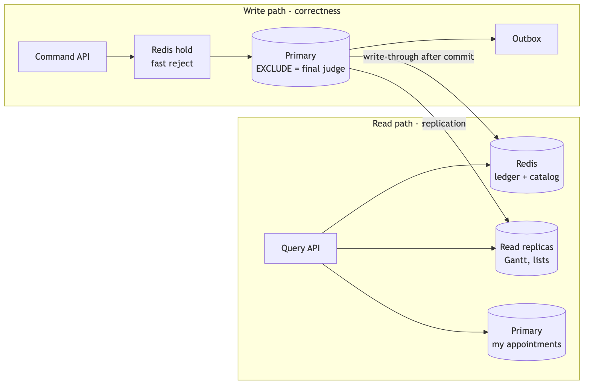

<sub>Source: [`docs/diagrams/08-cqrs-paths.mmd`](../diagrams/08-cqrs-paths.mmd)</sub>

- **Command side** (`…command` package): booking, reschedule, transitions, blocks. Uses the
  **primary** `DataSource`. Owns all writes and the outbox.
- **Query side** (`…query` package): availability, Gantt schedule, appointment lists and
  details. Uses the **replica** `DataSource` (Spring `AbstractRoutingDataSource` keyed on
  `@Transactional(readOnly = true)`), plus Redis.
- Same database schema; the split is logical and in the code, not two databases. An
  ArchUnit test forbids query code from calling command repositories and vice versa.

### 9.2 Redis caching (cache-aside, never authoritative)

| Key | Content | Source | TTL | Invalidation |
|---|---|---|---|---|
| `catalog:{dealershipId}` | services offered, durations, bays, technicians + skills, opening hours, zone | replica | 10 min | TTL (reference data changes rarely) |
| Slot ledger `ledger:{d:…}:*` (§8.6) | confirmed reservations + live holds per resource for a dealership-day | **primary** | marker 10 min | write-through after every commit; rebuilt on `23P01` |

The ledger is loaded from the **primary**, not a replica: one indexed query per
dealership-day, after which Redis absorbs the read storm. Loading it from a lagging replica
would bake stale data into it.

Redis down ⇒ cache calls fail fast (100 ms timeout, circuit breaker) and the service reads
the database directly: slower, still correct.

### 9.3 Availability computation

`GET /dealerships/{id}/availability?serviceTypeIds=…&from=2026-11-02&to=2026-11-08`

For each local date (max 14 days): take opening hours in the dealership zone, generate
candidate starts every 15 minutes, and keep a start if **some** (technician with all skills,
bay) pair has no overlap with the slot ledger (confirmed **and** live holds — a held slot
shows as taken, like an airline seat) for `period` / `bayPeriod`. Pure in-memory
computation over cached data (a dealership has tens of resources and at most a few hundred
reservations a day). The same function produces the `alternatives` returned with
`409 SLOT_UNAVAILABLE` (nearest 5 starts after the requested one).

Availability is a **hint**: it may be a few hundred ms stale. The command side is the
authority.

### 9.4 Read replicas and read-your-writes

| Read | Served from | Why |
|---|---|---|
| Command responses (`201`, `200` after PATCH) | the command transaction itself | Response body carries the full appointment, so the client never needs an immediate GET |
| `GET /me/appointments`, `GET /me/appointments/{id}` | **primary** | A customer who just booked must see it; volume is low |
| Gantt schedule, dispatcher lists | replica | High volume; replica lag (target < 1 s) is acceptable; every card carries `version`, and stale versions are rejected by `If-Match` anyway |
| Availability | Redis slot ledger (from primary) + catalog (from replica) | §9.2 |

## 10. Events — transactional outbox

### 10.1 Flow

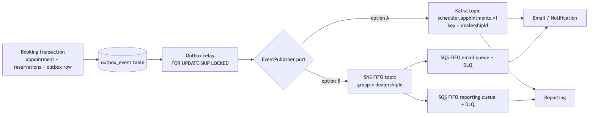

<sub>Source: [`docs/diagrams/09-event-flow.mmd`](../diagrams/09-event-flow.mmd)</sub>

1. The command transaction inserts an `outbox_event` row alongside the state change ⇒ the
   event exists **if and only if** the change committed.
2. The **outbox relay** polls `SELECT … WHERE published_at IS NULL ORDER BY occurred_at
   LIMIT 100 FOR UPDATE SKIP LOCKED` (safe with many relay instances), publishes, sets
   `published_at`. Delivery is **at-least-once**; consumers deduplicate by event `id`.
   Parallel relays can publish two events of one appointment out of order, so each event
   carries `aggregateVersion` (the appointment's `version` after the change) and consumers
   discard anything older than what they've already applied.
3. At higher volume, replace polling with Debezium CDC on the outbox table (design note).

The `EventPublisher` port has adapters:

| Adapter | Status | Mapping |
|---|---|---|
| `LoggingEventPublisher` | Built (local default) | Writes the event as a structured log line ⇒ visible in OpenSearch |
| `KafkaEventPublisher` | Design | Topic `scheduler.appointments.v1`, key = `dealershipId` ⇒ per-dealership ordering |
| `SnsSqsEventPublisher` | Design | SNS FIFO topic, `MessageGroupId = dealershipId`, `MessageDeduplicationId = event id`; each consumer has its own SQS FIFO queue + DLQ |

### 10.2 Event envelope (CloudEvents-style)

```json
{
  "id": "0192f0c2-7c1e-7a51-9f1a-2b3c4d5e6f70",
  "type": "AppointmentBooked",
  "schemaVersion": 1,
  "aggregateVersion": 0,
  "source": "scheduler/eu-west",
  "time": "2026-10-27T14:03:11.512Z",
  "dealershipId": "…",
  "data": {
    "appointmentId": "…", "customerId": "…", "vehicleId": "…",
    "serviceTypeCodes": ["OIL_CHANGE", "BRAKE_INSPECTION"],
    "serviceBayId": "…", "technicianId": "…",
    "start": "2026-11-02T09:00:00Z", "end": "2026-11-02T11:00:00Z",
    "timeZone": "Europe/London", "status": "BOOKED"
  }
}
```

Event types: `AppointmentBooked`, `AppointmentRescheduled` (old + new period/resources),
`AppointmentCancelled`, `AppointmentStatusChanged` (from, to), `ResourceBlockCreated`,
`ResourceBlockRemoved`. Payloads carry IDs, not PII (no email/phone); the Email service
looks contact details up via the Customer API under its own service identity.

### 10.3 Consumers (design)

- **Email/Notification** — confirmation, reschedule, cancellation, 24h reminder (scheduled
  from `AppointmentBooked`), in the dealership's time zone and customer's locale.
- **Reporting** — bay/technician utilisation, no-show rate, lead time, booking channel.
  Builds its own read model (e.g. warehouse); never queries the scheduler DB.
- **Live Gantt push** — a realtime service consumes events and pushes to dispatchers via
  SSE/WebSocket (design; the demo Gantt polls `GET /schedule` every 30 s).

## 11. Security

### 11.1 Gateway contract

The gateway (design-only) validates the JWT (signature via JWKS, `exp`, `aud`, `iss`) and
then, **after deleting any incoming `X-User-*` header**, injects:

| Header | Example | Meaning |
|---|---|---|
| `X-User-Id` | `6f1c…` (UUID) | Subject; for customers equals `customer.id` |
| `X-User-Roles` | `CUSTOMER` or `DISPATCHER` | Comma-separated roles |
| `X-Dealership-Ids` | `a1…,b2…` | Staff only: dealerships the user may act on |
| `X-Request-Id`, `traceparent` | | Correlation |

The gateway also checks the JWT `region` claim matches its own region (else `421`), so a
request only ever reaches the region that holds the caller's data (§12.1).

### 11.2 Trusting the headers safely

Trusting headers means anyone who reaches the service directly can impersonate anyone.
Controls (design): scheduler pods accept traffic only from the gateway (Kubernetes
NetworkPolicy / security groups, no public ingress), with mTLS between gateway and service
(service mesh). In code: a filter rejects requests missing `X-User-Id`/`X-User-Roles` with
`401`, parses them into a `CallerContext`, and malformed values ⇒ `401`. Locally, cURL
examples pass the headers by hand to stand in for the gateway.

### 11.3 IDOR prevention

IDs are UUIDv7 (non-sequential), but unguessable IDs are **not** authorization. Every query
is scoped by the caller:

- Customer endpoints live under `/me/…` and every repository method takes `customerId`
  from `CallerContext` (`WHERE id = :id AND customer_id = :caller`). A resource that exists
  but belongs to someone else returns **`404`**, indistinguishable from "does not exist".
- Booking validates that `vehicleId` belongs to the caller; a `holdId` is only usable by
  the user who created it (else `404`).
- Dispatchers reach customer data only through `/dealerships/{d}/customers…` (guarded by
  the dealership check); customer search requires at least 3 characters and caps results.
- Dispatcher-only endpoints (§14.4) live under `/dealerships/{dealershipId}/…`; a guard
  checks `dealershipId ∈ X-Dealership-Ids` (else `403`), and every query also filters by
  `dealership_id = :dealershipId`, so an appointment ID from another dealership is `404`.
- Shared catalog reads (`GET /dealerships`, `…/services`, `…/availability`) need an
  authenticated caller of **any** role (`CUSTOMER` or `DISPATCHER`) and skip the dealership
  guard. There are **no anonymous endpoints**: every request without identity headers is
  `401` (design-team call; anonymous browsing would be a gateway-level change later).
- Availability returns start times only — no technician names, bay names or other
  customers' data.
- Integration tests assert each of these (§17).

Defence in depth (design): PostgreSQL row-level security keyed on a session variable for
the dealership; gateway rate limits (e.g. 20 req/s per user on availability, 5 req/min per
user on booking) to blunt enumeration and slot-scraping.

### 11.4 Other

Bean Validation on all inputs; parameterised SQL only; no stack traces in error bodies;
secrets via environment/secret manager; dependency, code and container scanning (§16).

## 12. Multi-region and time

### 12.1 Regions (design)

- **One independent stack per region** (e.g. eu-west, us-east, ap-southeast): gateway,
  scheduler pods, PostgreSQL cluster (one primary + replicas), Redis cluster. Each region
  holds only its own dealerships, customers and appointments.
- **Routing by JWT**: the identity provider issues a `region` claim; the global load
  balancer routes on it; the gateway rejects a token for another region with `421`.
- **Single writer per dealership** follows automatically: a dealership's bays and
  technicians exist in exactly one database, so its `EXCLUDE` constraint is local and there
  is never a cross-region write conflict or any need for multi-master replication.
- **Data residency**: customer data stays in the customer's region, which suits GDPR-style
  rules by construction.
- **Disaster recovery**: async cross-region replica of each regional primary. RPO ≈ seconds,
  RTO ≈ 15 min by promoting the replica and pointing the region's DNS at it. During
  failover the region is read-only rather than writable in two places.

### 12.2 Time representation

| Concern | Decision |
|---|---|
| Storage | **UTC only**: `timestamptz` `start_at`/`end_at` (+ generated `tstzrange`); DB `timezone = 'UTC'`, JVM `-Duser.timezone=UTC`. Only opening hours are local wall-clock + `zone_id` (§7.3 explains why). |
| API input | ISO-8601 with any offset, e.g. `2026-11-02T09:00:00Z` or `2026-11-02T16:00:00+07:00` — both unambiguous, converted to UTC on arrival. Server checks the instant falls inside opening hours in the dealership zone. |
| API output | `start`/`end` in **UTC (`Z`)**, plus the dealership's `timeZone` (IANA) so clients render local time. Availability groups starts by the dealership's **local date** (`days[].date`), each start in UTC. |
| UI | B2C and Gantt convert UTC to **dealership local time** for display (that is what the customer drives to). A dispatcher in a remote call centre sees the dealership's zone labelled on the board. |
| DST gap (e.g. 01:30 on spring-forward day) | Availability is generated from local wall-clock opening hours with `ZonedDateTime`; non-existent local times are never offered. |
| DST overlap (01:30 happens twice) | The offset in the request disambiguates. |
| tzdata rule change after booking | We promised the customer the wall-clock time. A design-only reconciliation job re-checks future appointments against opening hours under the new rules and flags any that now fall outside them to dispatchers/notifications. |

### 12.3 Clock drift

All "now" comparisons that affect correctness (booking window, cancellation cutoff, no-show
grace) use PostgreSQL `now()` inside the command transaction, so one clock (the primary's)
decides. App servers run NTP (chrony) only for log timestamps. Overlap correctness never
depends on clocks at all — it is pure range arithmetic in the exclusion constraint. Client
clocks are never trusted.

### 12.4 Out of scope: cross-region use (deferred)

Deliberately left out to keep the design clear; the rare cases are:

- A customer booking at a dealership in another region (travel, moving country).
- A customer or fleet with vehicles serviced in two regions.

In this version such a customer simply doesn't see dealerships outside their region
(`GET /dealerships` lists the region's own dealerships). A future version could add a
small per-region **dealership directory** (`dealershipId → region`) at the gateway and
forward mismatched requests to the dealership's region, plus a fan-out for
`GET /me/appointments` — without changing the scheduler service.


## 13. Scaling and deployment

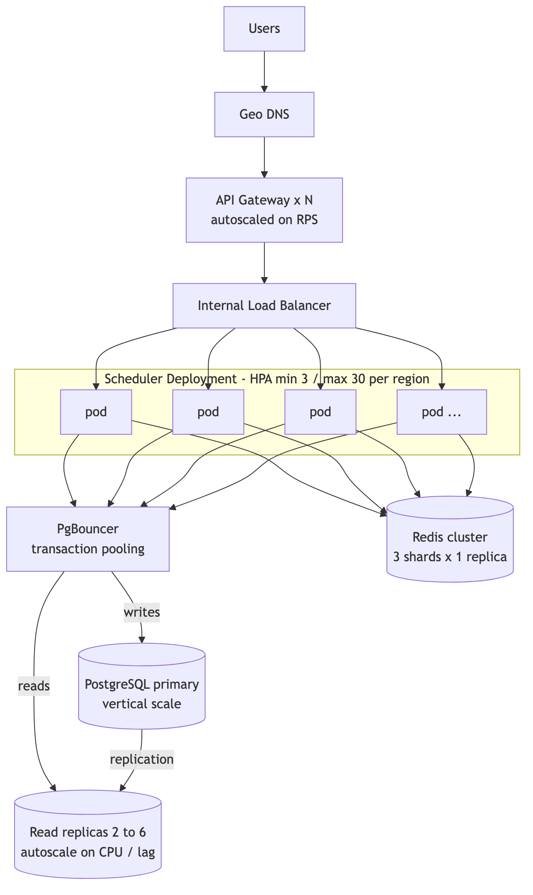

<sub>Source: [`docs/diagrams/05-scaling.mmd`](../diagrams/05-scaling.mmd)</sub>

| Layer | Scaling rule |
|---|---|
| Gateway | Managed / autoscaled on RPS |
| Scheduler pods | Stateless. HPA on CPU 60 % **and** RPS per pod (custom metric via Prometheus adapter). Min 3 across AZs; `PodDisruptionBudget` min 2. |
| Connections | PgBouncer (transaction pooling) in front of primary and replicas, so pod count can grow without exhausting PostgreSQL connections. |
| Primary | Vertical scale; ~330 writes/s/region is far below a single instance's limit. If a region outgrows it: shard by `dealership_id` (all data for a dealership already lives together, so sharding is natural). |
| Replicas | 2 minimum, autoscale to 6 on CPU or replica lag; app routes reads round-robin. |
| Redis | Cluster mode, 3 shards; keys are naturally distributed by dealership id. |
| Outbox relay | Separate small deployment (2 replicas), `SKIP LOCKED` makes them cooperate. |

Hot spots: one huge dealership on a Monday morning is still only a few writes per second
on a few dozen resources; the exclusion index handles that trivially.

## 14. API (REST, `/api/v1`, JSON)

The OpenAPI 3.1 spec is generated from code (springdoc) and committed as
`docs/api/openapi.yaml`; it doubles as the mocked client contract.

### 14.1 Conventions (and why)

| Rule | Why |
|---|---|
| Plural nouns, kebab-case paths, camelCase JSON, UUID ids | Standard, predictable REST naming |
| Customer-owned resources live under **`/me`**; staff resources under **`/dealerships/{dealershipId}`**; shared catalog reads under `/dealerships` | The path itself says whose data it is, and the scoping rule (§11.3) follows the path prefix |
| A resource is created and read at the **same** collection (`POST /me/appointments` → `Location: /me/appointments/{id}`) | `201 Created` + `Location` must point at the new resource (RFC 9110) |
| Field changes use **`PATCH`** with `application/merge-patch+json` (RFC 7396): sent fields change, omitted fields stay | Standard partial-update format, validates cleanly in OpenAPI |
| State changes that are not field edits are **action sub-resources**, one per action (`POST …/{id}/check-in`, `…/hold`, …), each with its own body schema | One polymorphic `transitions` endpoint would have fields that are required only for some actions — impossible to validate or document clearly |
| Times: input ISO-8601 with any offset; output **UTC `Z`** + dealership `timeZone` | §7.3 |
| Collections are wrapped: `{ "items": [...] }`; paginated ones add `"nextCursor"` (null at the end) with `limit` (default 20, max 100) and `cursor` params | Lets responses grow (counts, links) without breaking clients |
| Every single-appointment response carries `ETag: "<version>"`. `PATCH` and `reschedule` **require** `If-Match` (missing ⇒ `428`, stale ⇒ `412`); action endpoints accept it optionally | Lost-update protection (§8.4) using standard HTTP preconditions |
| `POST` that creates an appointment **requires** `Idempotency-Key` (1–64 chars). A replay returns the original status and body plus `Idempotency-Replayed: true` | Safe retries on flaky mobile networks (§8.5) |
| Every response echoes `X-Request-Id`; every error is `application/problem+json` (§14.6), including Spring's 405/406/415 | One error shape for clients and logs |
| `Cache-Control: private, max-age=300` on catalog reads; `no-store` on availability, holds, schedule and `/me/**` | Catalog changes rarely; everything else is live or personal |

### 14.2 Shared reads (any authenticated role)

| Method & path | Request | Success | Errors |
|---|---|---|---|
| `GET /dealerships` | — | `200` `{items:[{id, name, timeZone}]}` | 401 |
| `GET /dealerships/{dealershipId}/services` | — | `200` `{items:[{id, code, name, durationMinutes}]}` | 401, 404 |
| `GET /dealerships/{dealershipId}/availability` | `serviceTypeIds` (comma-separated, 1–5), `from`, `to` (dealership-local dates, range ≤ 14 days) | `200` availability (§14.5) — a closed or full day has `starts: []` | 400, 401, 404, 422 `SERVICE_NOT_OFFERED` |

### 14.3 Customer endpoints (role `CUSTOMER`)

| Method & path | Request | Success | Errors |
|---|---|---|---|
| `GET /me/vehicles` | — | `200` `{items:[Vehicle]}` | 401, 403 |
| `POST /me/vehicles` | `{vin, registration, make, model, modelYear, mileage}` | `201` + `Location: /me/vehicles/{id}` | 400, 401, 403, 409 `VEHICLE_ALREADY_EXISTS` |
| `GET /me/vehicles/{vehicleId}` | — | `200` Vehicle | 401, 403, 404 |
| `POST /me/holds` | `{dealershipId, vehicleId, serviceTypeIds, start}` | `201` + `Location: /me/holds/{id}`, body `{id, expiresAt, start, end, dealershipId, serviceTypeIds}` | 400, 401, 403, 404, 409 `SLOT_UNAVAILABLE`, 422 (`OUTSIDE_*`, `SERVICE_NOT_OFFERED`), 503 `HOLDS_UNAVAILABLE` |
| `GET /me/holds/{holdId}` | — | `200` hold (lets the UI restore its countdown after a reload) | 401, 403, 404 (missing, expired or not yours) |
| `DELETE /me/holds/{holdId}` | — | `204` — also when already expired or gone (DELETE is idempotent) | 401, 403 |
| `POST /me/appointments` | `Idempotency-Key`; `{holdId?, dealershipId, vehicleId, serviceTypeIds, start, customerNotes?}` (`customerNotes` ≤ 500 chars) | `201` + `Location: /me/appointments/{id}` + `ETag` | 400, 401, 403, 404, 409 `SLOT_UNAVAILABLE` / `REQUEST_IN_PROGRESS`, 422 (`OUTSIDE_*`, `SERVICE_NOT_OFFERED`, `HOLD_MISMATCH`, `IDEMPOTENCY_KEY_REUSED`), 428 |
| `GET /me/appointments` | `status?`, `from?`, `to?`, `limit?`, `cursor?` | `200` `{items:[Appointment], nextCursor}` | 400, 401, 403 |
| `GET /me/appointments/{appointmentId}` | — | `200` Appointment + `ETag` | 401, 403, 404 |
| `POST /me/appointments/{appointmentId}/reschedule` | `If-Match`; `{holdId}` (a hold taken for the new time) | `200` Appointment + new `ETag` | 401, 403, 404, 409 `SLOT_UNAVAILABLE` / `INVALID_TRANSITION`, 412, 422 `CHANGE_WINDOW_CLOSED` / `HOLD_MISMATCH`, 428 |
| `POST /me/appointments/{appointmentId}/cancel` | `If-Match?`; no body | `200` Appointment (status `CANCELLED`) | 401, 403, 404, 409 `INVALID_TRANSITION`, 412, 422 `CHANGE_WINDOW_CLOSED` |

### 14.4 Dispatcher endpoints (role `DISPATCHER`, `dealershipId` ∈ `X-Dealership-Ids`)

Every row below can also return `401` and `403`.

| Method & path | Request | Success | Errors |
|---|---|---|---|
| `GET /dealerships/{d}/schedule` | `date` (local), `groupBy` = `BAY` (default) \| `TECHNICIAN` | `200` schedule (§14.5) | 400 |
| `GET /dealerships/{d}/customers` | `q` (≥ 3 chars: email, phone or registration prefix), `limit` ≤ 20 | `200` `{items:[{id, displayName, email, phone, vehicles:[Vehicle]}]}` | 400 |
| `POST /dealerships/{d}/customers` | `{displayName, email?, phone?}` — at least one of email/phone | `201` + `Location: /dealerships/{d}/customers/{id}` | 400 |
| `GET /dealerships/{d}/customers/{customerId}` | — | `200` customer with vehicles | 404 |
| `POST /dealerships/{d}/customers/{customerId}/vehicles` | Vehicle body | `201` + `Location` | 400, 404, 409 `VEHICLE_ALREADY_EXISTS` |
| `POST /dealerships/{d}/appointments` | `Idempotency-Key`; `{customerId, vehicleId, serviceTypeIds, start, serviceBayId?, technicianId?, overrideHold?, customerNotes?}` | `201` + `Location: /dealerships/{d}/appointments/{id}` + `ETag` | 400, 404, 409 `SLOT_UNAVAILABLE` / `SLOT_HELD` / `REQUEST_IN_PROGRESS`, 422 (`OUTSIDE_*`, `SERVICE_NOT_OFFERED`, `TECHNICIAN_NOT_QUALIFIED`, `IDEMPOTENCY_KEY_REUSED`), 428 |
| `GET /dealerships/{d}/appointments/{id}` | — | `200` Appointment + `ETag` (used to refresh one card after a `412`) | 404 |
| `PATCH /dealerships/{d}/appointments/{id}` | `If-Match`; `application/merge-patch+json` `{start?, serviceBayId?, technicianId?, durationMinutes?, overrideHold?}` | `200` Appointment + new `ETag` | 400, 404, 409 `SLOT_UNAVAILABLE` / `SLOT_HELD` / `INVALID_TRANSITION` (terminal or `ON_HOLD`), 412, 415, 422 (`START_FIXED`, `TECHNICIAN_NOT_QUALIFIED`, `OUTSIDE_*`), 428 |
| `POST /dealerships/{d}/appointments/{id}/check-in` | `If-Match?`; — | `200` (`BOOKED → CHECKED_IN`) | 404, 409 `INVALID_TRANSITION`, 412 |
| `POST /dealerships/{d}/appointments/{id}/start` | `If-Match?`; — | `200` (`CHECKED_IN → IN_PROGRESS`) | 404, 409 `INVALID_TRANSITION`, 412 |
| `POST /dealerships/{d}/appointments/{id}/hold` | `If-Match?`; `{holdReason: PARTS \| CUSTOMER_APPROVAL, releaseBay?: false}` | `200` (`IN_PROGRESS → ON_HOLD`) | 400, 404, 409 `INVALID_TRANSITION`, 412 |
| `POST /dealerships/{d}/appointments/{id}/resume` | `If-Match?`; `{resumeAt?, technicianId?, serviceBayId?}` | `200` (`ON_HOLD → IN_PROGRESS`) | 400, 404, 409 `INVALID_TRANSITION` / `SLOT_UNAVAILABLE`, 412, 422 `TECHNICIAN_NOT_QUALIFIED` |
| `POST /dealerships/{d}/appointments/{id}/complete` | `If-Match?`; — | `200` (`IN_PROGRESS → COMPLETED`) | 404, 409 `INVALID_TRANSITION`, 412 |
| `POST /dealerships/{d}/appointments/{id}/no-show` | `If-Match?`; — | `200` (`BOOKED → NO_SHOW`) | 404, 409 `INVALID_TRANSITION`, 412, 422 `NO_SHOW_TOO_EARLY` |
| `POST /dealerships/{d}/appointments/{id}/cancel` | `If-Match?`; `{reason?}` (≤ 200 chars) | `200` (`BOOKED \| CHECKED_IN → CANCELLED`) | 404, 409 `INVALID_TRANSITION`, 412 |
| `POST /dealerships/{d}/resource-blocks` | `{resourceType: BAY \| TECHNICIAN, resourceId, start, end, reason}` | `201` + `Location: /dealerships/{d}/resource-blocks/{id}` | 400, 404 (resource), 409 `SLOT_UNAVAILABLE` with `conflicts[]` |
| `DELETE /dealerships/{d}/resource-blocks/{id}` | — | `204` | 404 |

Blocks are read through `GET …/schedule`; the block URI supports `DELETE` only.

### 14.5 Key payloads

**Book** — `POST /api/v1/me/appointments`

```http
X-User-Id: 6f1c0d7e-…      X-User-Roles: CUSTOMER
Idempotency-Key: 9b2f…     Content-Type: application/json

{
  "holdId": "0192f0b9-…",
  "dealershipId": "a1…",
  "vehicleId": "v9…",
  "serviceTypeIds": ["oil…", "brake…"],
  "start": "2026-11-02T09:00:00Z",
  "customerNotes": "Squeaking front left"
}
```

`201 Created`, `Location: /api/v1/me/appointments/0192f0c2-…`, `ETag: "0"`:

```json
{
  "id": "0192f0c2-…",
  "status": "BOOKED",
  "version": 0,
  "dealership": { "id": "a1…", "name": "Riverside Motors", "timeZone": "Europe/London" },
  "vehicle": { "id": "v9…", "registration": "AB12 CDE", "make": "Ford", "model": "Focus" },
  "services": [
    { "code": "OIL_CHANGE", "name": "Oil Change", "durationMinutes": 45 },
    { "code": "BRAKE_INSPECTION", "name": "Brake Inspection", "durationMinutes": 75 }
  ],
  "start": "2026-11-02T09:00:00Z",
  "end": "2026-11-02T11:00:00Z",
  "serviceBay": { "id": "…", "name": "Bay 3" },
  "technician": { "id": "…", "displayName": "Sam K." }
}
```

Customers see bay/technician names on their own confirmation (product choice); availability
never shows them.

**Hold** — `POST /api/v1/me/holds` ⇒ `201`, `Location: /api/v1/me/holds/0192f0b9-…`:

```json
{ "id": "0192f0b9-…", "dealershipId": "a1…", "serviceTypeIds": ["oil…", "brake…"],
  "start": "2026-11-02T09:00:00Z", "end": "2026-11-02T11:00:00Z", "expiresAt": "2026-10-28T14:13:11Z" }
```

**Availability** — `200`:

```json
{
  "dealershipId": "a1…", "timeZone": "Europe/London", "durationMinutes": 120,
  "days": [
    { "date": "2026-11-02", "starts": ["2026-11-02T08:00:00Z", "2026-11-02T08:15:00Z"] },
    { "date": "2026-11-08", "starts": [] }
  ]
}
```

**Gantt schedule** — `200`:

```json
{
  "date": "2026-11-02", "timeZone": "Europe/London", "groupBy": "BAY",
  "openingHours": { "opens": "08:00", "closes": "18:00" },
  "lanes": [ { "id": "0192e1a0-…", "type": "BAY", "name": "Bay 3" } ],
  "technicians": [ { "id": "0192e1b4-…", "displayName": "Sam K.", "skills": ["OIL", "BRAKES"] } ],
  "items": [
    { "kind": "APPOINTMENT", "id": "0192f0c2-…", "version": 2, "status": "ON_HOLD", "holdReason": "PARTS",
      "laneId": "0192e1a0-…", "technicianId": null, "start": "2026-11-02T09:00:00Z", "end": "2026-11-02T09:40:00Z",
      "remainingMinutes": 80, "vehicle": "AB12 CDE · Ford Focus", "services": ["OIL_CHANGE", "BRAKE_INSPECTION"], "overrun": false },
    { "kind": "BLOCK", "id": "0192f0d1-…", "laneId": "0192e1a0-…", "start": "2026-11-02T14:00:00Z",
      "end": "2026-11-02T16:00:00Z", "reason": "Lift maintenance" }
  ]
}
```

**Drag-and-drop** — `PATCH /api/v1/dealerships/{d}/appointments/{id}`,
`If-Match: "2"`, `Content-Type: application/merge-patch+json`:

```json
{ "start": "2026-11-02T13:00:00Z", "serviceBayId": "0192e1a0-…" }
```

### 14.6 Errors (RFC 9457 `application/problem+json`)

**Message rules.** `title` is fixed per `code` (clients may translate it). `detail` is one
specific, human sentence that says what was wrong and, when possible, what to do next; times
in `detail` are in the dealership's local time with its zone name, while machine fields
(`alternatives`, `conflicts`) stay UTC. A `404` never reveals whether the resource exists for
someone else. No stack traces, SQL or internal ids of other users ever appear. Every problem
carries `code`, `traceId`, and `errors[]` for validation failures.

| HTTP | `code` | `title` | Example `detail` |
|---|---|---|---|
| 400 | `VALIDATION_ERROR` | Request is invalid | "2 fields are invalid." + `errors: [{field: "vin", message: "must be 17 characters"}]` |
| 401 | `UNAUTHENTICATED` | Authentication required | "Missing or invalid identity headers." |
| 403 | `FORBIDDEN` | Not allowed | "Your account cannot act for dealership a1…." |
| 404 | `NOT_FOUND` | Resource not found | "Appointment not found." |
| 405 / 406 / 415 | `METHOD_NOT_ALLOWED` / `NOT_ACCEPTABLE` / `UNSUPPORTED_MEDIA_TYPE` | (standard) | "PATCH requires Content-Type application/merge-patch+json." |
| 409 | `SLOT_UNAVAILABLE` | Requested time is not available | "No qualified technician and bay are free at 09:00 on Mon 2 Nov (Europe/London)." + `alternatives[]` (+ `conflicts[]` for dispatchers) |
| 409 | `SLOT_HELD` | Time is held by a customer | "A customer is holding this time until 09:41 (Europe/London). Resend with overrideHold=true to take it." |
| 409 | `INVALID_TRANSITION` | Action not allowed in current status | "Cannot start an appointment that is BOOKED; check it in first." |
| 409 | `REQUEST_IN_PROGRESS` | Duplicate request in progress | "A request with this Idempotency-Key is still being processed. Retry shortly." + `Retry-After: 1` |
| 409 | `VEHICLE_ALREADY_EXISTS` | Vehicle already registered | "This customer already has a vehicle with this VIN." |
| 412 | `VERSION_CONFLICT` | Appointment was changed by someone else | "You edited version 2 but the current version is 3. Reload and try again." |
| 421 | `MISDIRECTED_REGION` *(gateway)* | Wrong region | "This account belongs to region eu-west." |
| 422 | `OUTSIDE_BOOKING_WINDOW` | Time is outside the booking window | "Online bookings must start at least 2 hours from now and within 60 days." |
| 422 | `OUTSIDE_OPENING_HOURS` | Outside opening hours | "Riverside Motors is open 08:00–18:00 on Mondays; a 120-minute job starting at 17:00 would end after closing." |
| 422 | `CHANGE_WINDOW_CLOSED` | Too late to change | "This appointment starts in 6 hours; online changes close 24 hours before. Please call the dealership." |
| 422 | `SERVICE_NOT_OFFERED` | Service not offered here | "Brake Inspection is not offered at Riverside Motors." |
| 422 | `TECHNICIAN_NOT_QUALIFIED` | Technician lacks required skills | "Lee P. does not have the BRAKES skill required by Brake Inspection." |
| 422 | `START_FIXED` | Start time can no longer change | "Work has already started; you can still change the technician, bay or end time." |
| 422 | `NO_SHOW_TOO_EARLY` | Too early to mark no-show | "No-show can be recorded from 09:30 (30 minutes after the start)." |
| 422 | `HOLD_MISMATCH` | Hold does not match the request | "Your hold is for 09:00 with Oil Change; this request asks for 10:00." |
| 422 | `IDEMPOTENCY_KEY_REUSED` | Idempotency key reused | "This Idempotency-Key was already used with a different request body." |
| 428 | `PRECONDITION_REQUIRED` | Precondition header required | "If-Match header is required for this request." |
| 429 | `RATE_LIMITED` *(gateway)* | Too many requests | "Too many hold requests; try again in 10 seconds." + `Retry-After: 10` |
| 500 | `INTERNAL_ERROR` | Unexpected error | "Something went wrong. Quote the traceId when contacting support." |
| 503 | `HOLDS_UNAVAILABLE` | Slot holds temporarily unavailable | "Holds are unavailable right now; you can still book directly." + `Retry-After: 30` |
| 503 | `SERVICE_UNAVAILABLE` | Service temporarily unavailable | "Please retry shortly." + `Retry-After: 5` |

**Why 409 vs 412 vs 422.** `409` = the request clashes with the *current state* of a
resource (time taken, wrong status, duplicate). `412` = the client's `If-Match` precondition
failed (someone else changed it). `422` = the request is well-formed but breaks a business
rule regardless of current state. `400` = malformed input.

```json
{
  "type": "https://scheduler.example/problems/slot-unavailable",
  "title": "Requested time is not available",
  "status": 409,
  "detail": "No qualified technician and bay are free at 09:00 on Mon 2 Nov (Europe/London).",
  "instance": "/api/v1/me/appointments",
  "code": "SLOT_UNAVAILABLE",
  "traceId": "4bf92f3577b34da6a3ce929d0e0e4736",
  "alternatives": ["2026-11-02T09:15:00Z", "2026-11-02T10:00:00Z"]
}
```

## 15. UI design (mockups — not built)

Rendered mockups (PNG) with their HTML sources in `docs/ui/`. Re-render with any headless
browser if the HTML changes.

### 15.1 B2C booking flow (mirrors Keyloop / Xtime: vehicle → services → time → confirm)

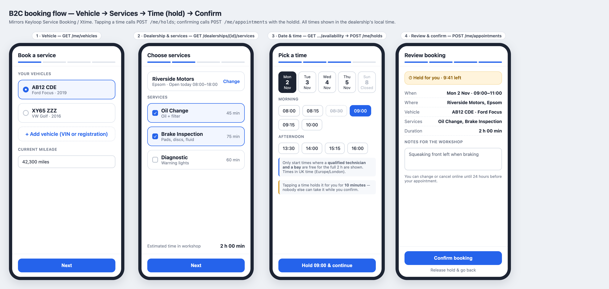

Tapping a time calls `POST /me/holds`; the review screen shows the 10-minute hold countdown
and confirms with `POST /me/appointments` + `holdId`. Closed days are shown but disabled;
times taken by other customers' holds simply don't appear.

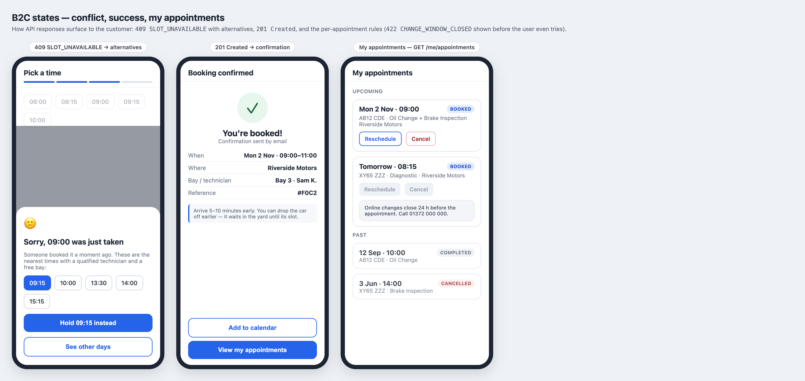

- **409 `SLOT_UNAVAILABLE`** becomes a bottom sheet with the `alternatives[]`; one tap holds
  the new time.
- **My appointments**: Reschedule / Cancel are disabled inside 24 h with the reason shown up
  front, so the user never has to hit `422 CHANGE_WINDOW_CLOSED`.

### 15.2 Dispatcher Gantt board

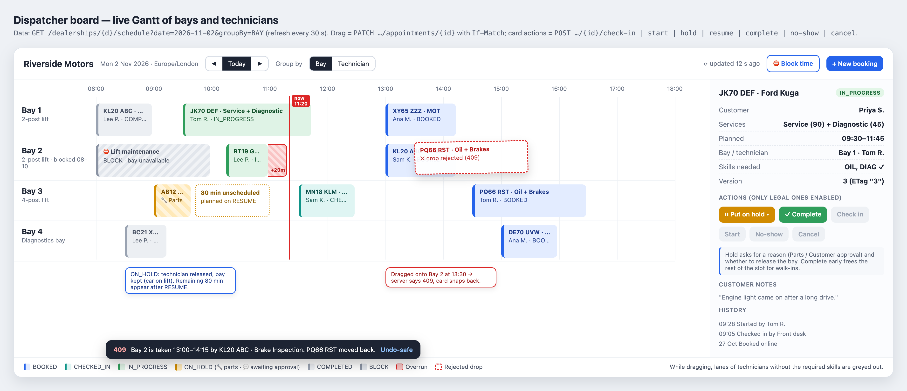

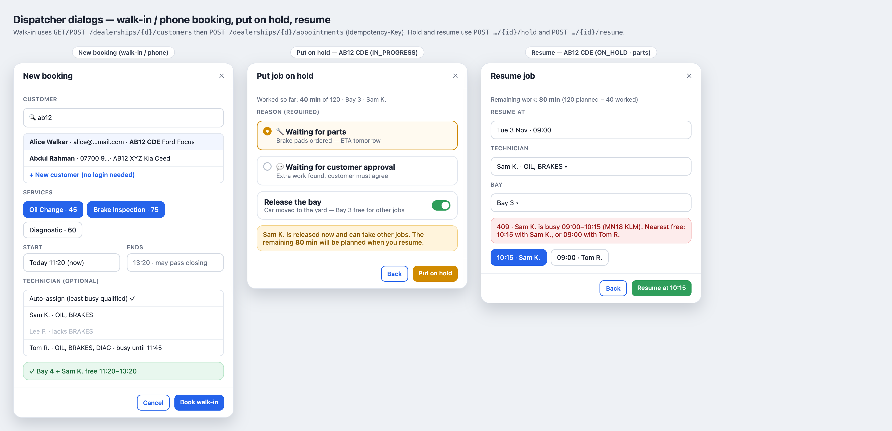

Interactions → API:

| Gesture | Call | On failure |
|---|---|---|
| Drag card horizontally | `PATCH` with new `start`, `If-Match` | `409`/`412` ⇒ card snaps back, toast names the conflict, board refreshes |
| Drag to another lane | `PATCH` with `serviceBayId` (bay view) or `technicianId` (tech view) | `422 TECHNICIAN_NOT_QUALIFIED` ⇒ snap back; lanes of unqualified techs are greyed while dragging (skills come in the schedule payload) |
| Drag card edge | `PATCH` with `durationMinutes` | as above |
| Card menu | `POST …/{id}/check-in`, `/start`, `/hold`, `/resume`, `/complete`, `/no-show`, `/cancel` | `409 INVALID_TRANSITION` ⇒ menu only shows legal actions anyway |
| Select empty range on a lane | `POST …/resource-blocks` | `409` lists overlapping jobs |

The UI never decides correctness: it predicts conflicts for good UX, and the server's
answer always wins.

## 16. Technology choices

| Technology | Why |
|---|---|
| Java 21 + Spring Boot 3.x | Mature, well known to reviewers; virtual threads for cheap blocking I/O; first-class Testcontainers, Actuator, Micrometer |
| PostgreSQL 16 | `tstzrange` + `EXCLUDE USING gist` is the core correctness mechanism; streaming replicas; mature RLS |
| Spring JDBC / `JdbcClient` (+ Spring Data for simple reads) | Range types and exclusion errors are clearer in explicit SQL than through JPA mappings (builder may choose JPA where it fits) |
| Flyway | Versioned schema + seed data |
| Redis 7 (Lettuce) | Fast cache-aside; cluster mode for scale |
| springdoc-openapi | Generates the API contract used as the client stub |
| logstash-logback-encoder | JSON logs with MDC fields |
| Fluent Bit + OpenSearch 2.x + Dashboards | Required log stack; open-source, runs in Docker |
| Micrometer + Prometheus; OpenTelemetry Java agent | Metrics and traces with vendor-neutral formats |
| JUnit 5, AssertJ, Testcontainers, RestAssured/MockMvc, ArchUnit | Unit, real-Postgres concurrency, API and architecture tests |
| Maven | Build; runs Spotless, Checkstyle, JaCoCo, OWASP checks in `verify` |
| Docker Compose | One-command local stack |
| Kafka or SNS/SQS, Kubernetes + HPA, API Gateway, OIDC IdP | Design-only production components |

## 17. Quality, security tooling and tests

**Build gates (`mvn verify`)**
- Spotless (google-java-format) — formatting.
- Checkstyle (Google checks, build fails on violation).
- **Two suites:** unit tests (`*Test`, no Spring, no Docker) and integration tests (`*IT`, real PostgreSQL + Redis via Testcontainers). Every feature has both.
- JaCoCo — **unit tests alone ≥ 90 % line / ≥ 80 % branch** (infrastructure-bound classes — controllers, repositories, Redis ledger, config — are excluded from this gate) and **unit + integration merged ≥ 90 % line** over all code. Either gate failing fails the build.
- OWASP Dependency-Check — fails on CVSS ≥ 7 (account-free fallback).
- ArchUnit — command/query separation, no controller → repository shortcuts.

**Snyk (local, needs a free account + `snyk auth`)**: `snyk test` (dependencies),
`snyk code test` (SAST), `snyk container test scheduler:local` (image). Wrapped in a
`make security` (or script) target and documented in the README.

**Test suite**
| Layer | Examples |
|---|---|
| Unit | Duration and period maths; opening-hours check incl. DST gap/overlap; state machine (every legal and illegal transition); allocation ranking; availability generation |
| Integration (Testcontainers Postgres + Redis) | `EXCLUDE` rejects overlap for bay and technician; back-to-back allowed; 45 min vs 75 min overlapping requests; bay buffer; cancelled/no-show frees time; block vs appointment conflicts; outbox row written iff commit |
| **Concurrency** (double-booking proof; every test ends by checking in SQL that no two active reservations on one resource overlap) | 50 threads, same start, 1 bay + 1 technician ⇒ exactly 1 success (repeated 5×); 45-min vs 75-min overlapping requests ⇒ 1 success; capacity 3 ⇒ exactly 3 successes on distinct technicians and bays; 100 random overlapping requests ⇒ results pairwise disjoint; bay buffer under race; holds vs direct bookings; all write paths at once (customer confirm, walk-in, drag-and-drop, block); resume vs new booking; cancel vs rebook; **two application instances** sharing one database and Redis ⇒ still exactly 1 success; two dispatchers on the same version ⇒ one `200`, one `412`; check-in vs cancel ⇒ one wins; duplicate idempotency key in parallel ⇒ one appointment |
| **Redis failure modes** | Flush the ledger mid-test, then book ⇒ still no double booking and ledger rebuilds; stop Redis ⇒ `/holds` `503`, direct booking works; expired hold confirm ⇒ `201` if free, `409` if taken; dispatcher onto a held slot ⇒ `409 SLOT_HELD`, with override ⇒ `200` |
| API / security | Every endpoint without identity headers ⇒ `401`; customer B reading/cancelling customer A's appointment ⇒ `404`; booking with someone else's vehicle ⇒ `404`; dispatcher on a dealership not in header ⇒ `403`; idempotent retry returns same appointment |
| Cache | Redis stopped ⇒ availability and booking still correct |
| Load (design + script) | k6 script for availability and booking mix; reported, not gated |

## 18. Observability

**Logs** — JSON to stdout with `timestamp`, `level`, `logger`, `message`, `traceId`,
`spanId`, `requestId`, `userId` (UUID only, no PII), `dealershipId`, `appointmentId`,
`event`. Docker's fluentd log driver → Fluent Bit → OpenSearch index `scheduler-logs-*`;
an OpenSearch Dashboards saved search/dashboard is provisioned for: bookings, conflicts,
errors by code. Business events (`AppointmentBooked`…) are also logged by the
`LoggingEventPublisher`, so the full lifecycle is searchable.

**Metrics** (Micrometer, `/actuator/prometheus`)
- `scheduler_booking_attempts_total{outcome=created|conflict|rejected}`
- `scheduler_allocation_retries_total`, `scheduler_exclusion_violations_total`
- `scheduler_availability_latency_seconds` (histogram), cache hit ratio by cache
- `scheduler_outbox_backlog`, `scheduler_outbox_publish_lag_seconds`
- DB pool usage, replica lag (exporter)

**Tracing** — OpenTelemetry Java agent; `traceparent` propagated from the gateway; spans
for HTTP, JDBC, Redis, outbox publish. Trace id is echoed in every problem response.

**SLOs and alerts (design)**
| SLO | Target |
|---|---|
| Booking API availability | 99.9 % monthly |
| `POST /me/appointments` latency | p99 < 300 ms |
| Availability latency | p99 < 150 ms |
| Event delivery | 99 % published < 5 s after commit |

Alerts: error budget burn, conflict-rate spike (UX or scraping signal), outbox backlog > 1k
or lag > 30 s, replica lag > 2 s, Redis circuit open.

## 19. Local development (Docker Compose)

```
docker compose up --build
```

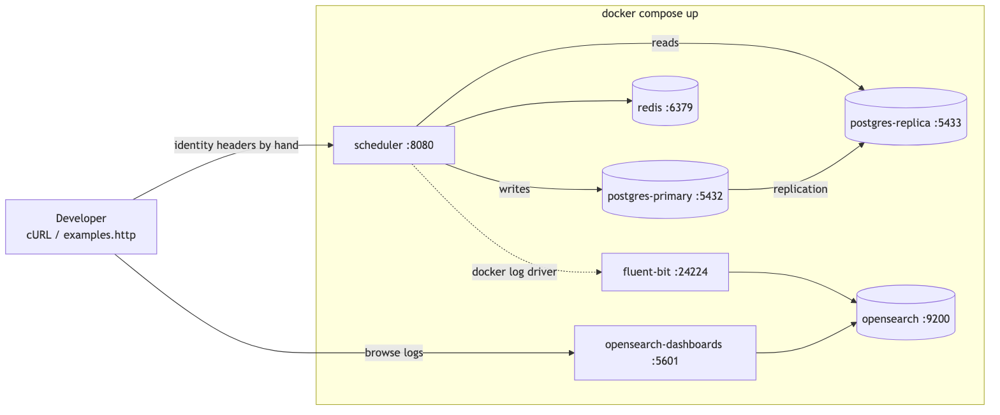

<sub>Source: [`docs/diagrams/10-local-docker.mmd`](../diagrams/10-local-docker.mmd)</sub>

| Service | Image (pinned in compose) | Port |
|---|---|---|
| `scheduler` | built from `Dockerfile` (multi-stage, JRE 21, non-root) | 8080 |
| `postgres-primary` | bitnami/postgresql 16 (replication master) | 5432 |
| `postgres-replica` | bitnami/postgresql 16 (replica) | 5433 |
| `redis` | redis 7 | 6379 |
| `opensearch` | opensearchproject/opensearch 2.x, single node, security plugin disabled for local | 9200 |
| `opensearch-dashboards` | opensearchproject/opensearch-dashboards 2.x | 5601 |
| `fluent-bit` | fluent/fluent-bit | 24224 |

Flyway seeds: 2 dealerships in different zones (e.g. `Europe/London`, `America/New_York`),
3 bays and 4 technicians with mixed skills each, a service catalog, 2 customers with
vehicles. `docs/api/examples.http` + a cURL script exercise the whole flow, passing identity
headers by hand in place of the gateway. Health: `/actuator/health` (readiness includes DB
and Redis — Redis down ⇒ degraded, not down).

## 20. Approaches considered

| | A. Logical CQRS + replicas + Redis cache-aside | B. Full CQRS with event-driven projections | C. Event sourcing |
|---|---|---|---|
| Shape | One schema; command/query split in code; reads from replicas + Redis | Outbox → broker → projectors build denormalised read stores | Event store is the system of record |
| Pros | Simple, fully testable locally, comfortably meets ~10k reads/s & ~1k writes/s | Read side scales and evolves independently; fastest reads | Full audit history |
| Cons | Gantt reads join normalised tables | Broker + projectors + replay; seconds of lag; much harder to test | `EXCLUDE` needs current-state tables; overlap checks become hard |
| Verdict | **Chosen** | **Evolution path** | Rejected |

**When to move from A to B**: replica lag regularly > 1 s, Gantt p99 > 200 ms, or a new
consumer needs a read shape the OLTP schema can't serve. The outbox and event envelope
already exist, so B is additive: add projectors that consume the same events.

## 21. How GenAI was used in the design phase

- **Tooling**: Claude Code with the Superpowers `brainstorming` skill. Its hard gate forbade
  any code or scaffolding until this document is approved.
- **Adversarial prompting**: I instructed the agent to act as a cynical Principal
  Distributed Systems Engineer and interrogate concurrency, bottlenecks, multi-region time
  and IDOR before proposing anything.
- **Grounding**: the agent read the official challenge PDF (it flagged that only one layer
  must be implemented, which shaped the backend-only scope) and researched real products
  (Keyloop Service Booking, Xtime, dispatch boards) to derive the booking flow, lifecycle
  states and capacity model, and Keyloop's published footprint for the capacity estimate.
- **Challenge and resolve**: each of my directions was challenged and resolved — e.g. the
  agent rejected Redis locks in favour of my `EXCLUDE` choice and added the partial
  constraint; flagged header spoofing behind the gateway; flagged the replica
  read-your-writes trap; argued full CQRS was premature given the numbers. The complete
  record is in `docs/ai-collaboration/decision-log.md`.
- **Verification**: a separate reviewer agent read this document cold as the future
  builder and listed what it would still have to guess; those gaps were resolved before
  approval.

## 22. Left to the builder

- Package layout inside the command/query split (hexagonal or layered), as long as ArchUnit
  rules hold.
- JDBC vs JPA per repository; DDL details, index tuning, migration file breakdown.
- Exact seed data, cURL scripts, k6 script contents.
- Retry/backoff constants, cache TTL fine-tuning, pagination cursor format.
- Error message wording; OpenAPI annotations.
- Docker image tags (pin exact versions), Fluent Bit parser config, OpenSearch dashboard
  layout.
